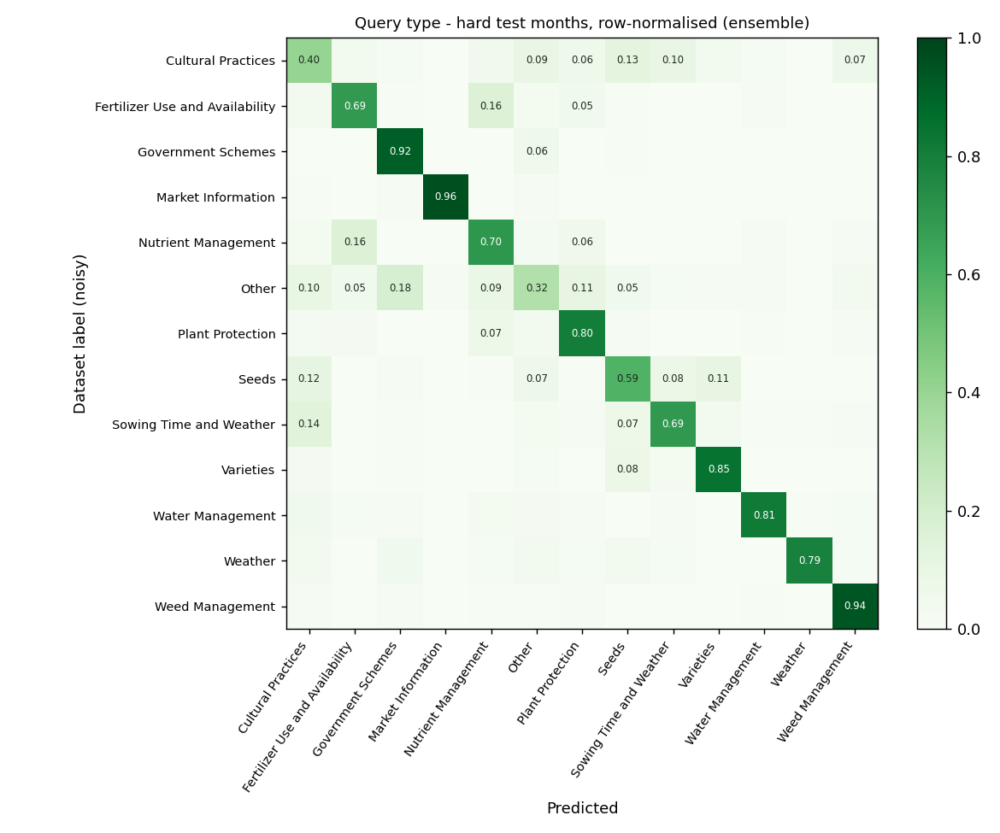

# Stage 2 - Query classifiers

Generated by `python -m src.triage.classifier`.

> **Read this first.** Every score below is measured against the dataset's own
> `QueryType`/`Crop` labels, which the source of truth documents as noisy. These are
> *agreement with historical call-taker labels*, not accuracy. The golden-set
> evaluation (hand-checked labels) is still to be built.

**Protocol.** Train on distinct (question, label) pairs from 2023-11..2024-10; pick C and
the runtime variant on the validation months (2024-11..12); report on the untouched
test months (2025-01..07). *Hard* = questions whose normalised text (`q_key`) never
appeared in train or valid. Realistic (all rows) numbers are inflated by repeat
template calls and are shown for completeness only.

## Query type (13 classes)

| Variant | Valid macro-F1 | Valid-hard macro-F1 | Test macro-F1 | **Test-hard macro-F1** | Test-hard accuracy |
|---|---:|---:|---:|---:|---:|
| majority_class | 0.030 | 0.039 | 0.014 | **0.024** | 0.184 |
| tfidf | 0.624 | 0.698 | 0.571 | **0.665** | 0.786 |
| embedding | 0.609 | 0.674 | 0.559 | **0.636** | 0.741 |
| ensemble (selected) | 0.629 | 0.719 | 0.574 | **0.676** | 0.787 |

Rows: valid 29,818 (hard 11,683), test 126,407 (hard 38,537). Chosen C = 1.0.

**Label-noise ceiling.** 62.7% of test rows belong to a question text that was given different labels on different calls, so even a perfect lookup could agree with the labels at most **76.5%** of the time (realistic) and 97.5% (hard). This is why realistic scores sit *below* hard ones.

Per class, hard test months, selected variant:

| Class | Precision | Recall | F1 | Support |
|---|---:|---:|---:|---:|
| Government Schemes | 0.96 | 0.92 | 0.94 | 14,442 |
| Plant Protection | 0.88 | 0.80 | 0.84 | 7,111 |
| Nutrient Management | 0.69 | 0.70 | 0.70 | 3,669 |
| Cultural Practices | 0.52 | 0.40 | 0.45 | 2,380 |
| Other | 0.30 | 0.32 | 0.31 | 2,195 |
| Market Information | 0.95 | 0.96 | 0.96 | 2,186 |
| Fertilizer Use and Availability | 0.57 | 0.69 | 0.62 | 1,930 |
| Weed Management | 0.80 | 0.94 | 0.87 | 1,769 |
| Seeds | 0.47 | 0.59 | 0.52 | 1,094 |
| Varieties | 0.75 | 0.85 | 0.80 | 943 |
| Sowing Time and Weather | 0.40 | 0.69 | 0.51 | 429 |
| Water Management | 0.57 | 0.81 | 0.67 | 328 |
| Weather | 0.49 | 0.79 | 0.60 | 61 |

## Crop (30 specific crops)

Rows labelled `Others`, blank or too rare are excluded. At runtime a crop named in
the question (lexicon) wins; the classifier is only a fallback and is ignored below
the configured confidence.

| Variant | Valid macro-F1 | Valid-hard macro-F1 | Test macro-F1 | **Test-hard macro-F1** | Test-hard accuracy |
|---|---:|---:|---:|---:|---:|
| majority_class | 0.004 | 0.003 | 0.010 | **0.006** | 0.095 |
| tfidf | 0.730 | 0.868 | 0.672 | **0.909** | 0.910 |
| embedding | 0.737 | 0.858 | 0.663 | **0.899** | 0.910 |
| ensemble (selected) | 0.723 | 0.884 | 0.659 | **0.915** | 0.918 |

Rows: valid 21,325 (hard 8,365), test 65,159 (hard 17,934). Chosen C = 16.0.

**Label-noise ceiling.** 57.6% of test rows belong to a question text that was given different labels on different calls, so even a perfect lookup could agree with the labels at most **61.8%** of the time (realistic) and 99.0% (hard). This is why realistic scores sit *below* hard ones.

## Cross-lingual probes (Marathi / Hindi / romanised)

The training text is English; farmers will not be. Hand-written probe questions with
the expected query type (`config/gate_probes.csv`, `lang != en`):

| Variant | Correct | Share |
|---|---:|---:|
| tfidf | 0/13 | 0% |
| embedding | 8/13 | 62% |
| ensemble | 8/13 | 62% |

## Notes

- XGBoost on embeddings (source-of-truth comparison) is not run here: XGBoost is not
  yet a project dependency. Logistic regression on the same embeddings is the
  stand-in; swapping the estimator is a one-line change in `TaskModel`.
- `Other` folds 60 rare labels together, so its F1 is expected to be weak.
