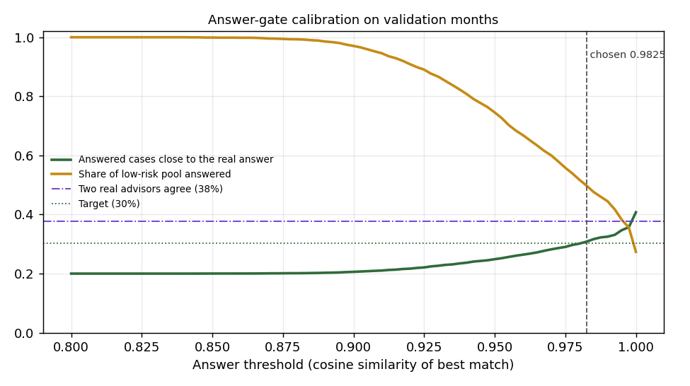

# Stage 2 - Gate calibration and evaluation

Generated by `python -m src.triage.evaluate`.

> **How "close" is measured.** Character n-gram cosine >= 0.5 between a served historical answer and the real answer
> given on that call. It rewards matching what an advisor said, not agronomic correctness.
> Advisors themselves word answers very differently, so the proxy is read *relative to
> advisor agreement*: how often a second real advisor's answer to the same question is close.
> It stays a proxy until the hand-checked golden set exists.

## 1. Calibration (validation months, KB = train months only)

- **Advisor agreement:** for 1,245 validation calls whose question was already in the KB,
  another real advisor's answer to the same question was close only **37.8%** of the time
  (mean closeness 0.466). An absolute target like 80% is unreachable by construction.
- **Answer threshold:** `0.9825`, the lowest best-match similarity at which answered cases are close to the real answer at least 30.3% of the time (80% of advisor agreement).
  Answering the whole low-risk pool (3,029 rows) would be close 20.0% of the time.
- **Out-of-scope threshold:** `0.851`, the 1st percentile of best-match
  similarity over 9,930 real validation questions *without farm words* (the
  only questions the rule can apply to). Questions with farm words are never called out of scope.

## 2. Test months (2025-01..07), KB frozen at 2024-12

Random sample of test rows; caller profile = district + month, crop only from the
question. *Hard* = questions whose `q_key` never appeared before 2025.

| Metric | Realistic | Hard |
|---|---:|---:|
| Rows evaluated | 40,000 | 12,266 |
| Route share: `ANSWER` | 2.8% | 2.3% |
| Route share: `CLARIFY` | 2.4% | 6.2% |
| Route share: `SCHEME_POINTER` | 27.5% | 34.8% |
| Route share: `LIVE_DATA_POINTER` | 43.1% | 5.9% |
| Route share: `EXPERT_REVIEW` | 24.3% | 50.8% |
| Route share: `OUT_OF_SCOPE` | 0.0% | 0.0% |
| **Auto-answer coverage** | 2.8% | 2.3% |
| **Answered cases close to the real answer** | 27.2% | 13.1% |
| Reference: second real advisor close, same answered questions | 31.2% (n=830) | - (n=0) |
| Same low-risk pool answered without a threshold | 14.5% | 6.6% |
| Mean closeness when answering | 0.365 | 0.264 |
| **Chemical answers served automatically** | 0 | 0 |
| Answered although the real answer was chemical | 5.9% | 10.3% |
| Time-sensitive rows | 23,402 | 2,938 |
| ... sent to a live/scheme pointer | 99.8% | 98.7% |
| **... answered from history** | 0.0% | 0.0% |
| Rows whose real answer was chemical | 8,170 | 4,732 |
| ... sent to expert or clarify | 99.0% | 99.2% |
| **... answered automatically** | 0.8% | 0.6% |
| Government-scheme rows | 11,124 | 4,483 |
| ... sent to the scheme pointer | 94.2% | 89.9% |

Hard-mode advisor agreement covers only answered questions whose `q_key` exists in the KB,
which by definition excludes most hard rows; read it as indicative.

**Limit of the safety rows.** "Chemical" and "time-sensitive" are decided by the same
policy detectors that build the KB, so these rows prove the *gate* never serves what the
detectors flag; they cannot reveal what the detectors miss. Detector misses were hunted by
reading samples and served answers by hand; two found that way (per-piece mandi prices,
instalment-date phrasings) are fixed and covered by `tests/test_policy.py`.

## 3. Probe set (full engine, production KB)

Hand-written probes in `config/gate_probes.csv`: **31/37 routed as expected.**
These are a smoke test written by the developer, not the golden set. Failures are kept
visible on purpose.

| Lang | Question | Expected | Got | Reason | Best sim |
|---|---|---|---|---|---:|
| en | MARKET RATE OF ONION ? | LIVE_DATA_POINTER | LIVE_DATA_POINTER | LIVE_MARKET_INTENT | 0.942 |
| en | What is the cotton price in Akola mandi today | LIVE_DATA_POINTER | LIVE_DATA_POINTER | LIVE_MARKET_INTENT | 0.864 |
| mr | कांद्याचा आजचा बाजारभाव काय आहे | LIVE_DATA_POINTER | LIVE_DATA_POINTER | LIVE_MARKET_INTENT | 0.847 |
| mr | सोयाबीनला आज काय भाव आहे | LIVE_DATA_POINTER | LIVE_DATA_POINTER | LIVE_MARKET_INTENT | 0.874 |
| hi | प्याज का आज का भाव क्या है | LIVE_DATA_POINTER | LIVE_DATA_POINTER | LIVE_MARKET_INTENT | 0.874 |
| en | Weather forecast for next week | LIVE_DATA_POINTER | LIVE_DATA_POINTER | LIVE_WEATHER_INTENT | 0.829 |
| mr | उद्या पाऊस पडेल का | LIVE_DATA_POINTER | LIVE_DATA_POINTER | LIVE_WEATHER_INTENT | 0.835 |
| hi | अगले हफ्ते मौसम कैसा रहेगा | LIVE_DATA_POINTER | LIVE_DATA_POINTER | LIVE_WEATHER_INTENT | 0.839 |
| en | Status of installment in PM Kisan Samman Nidhi Yojana | SCHEME_POINTER | SCHEME_POINTER | SCHEME_INTENT | 0.952 |
| mr | पीएम किसान योजनेचा पुढचा हप्ता कधी येणार | SCHEME_POINTER | SCHEME_POINTER | SCHEME_INTENT | 0.856 |
| en | Crop insurance helpline number | SCHEME_POINTER | SCHEME_POINTER | SCHEME_INTENT | 0.989 |
| mr | पीक विमा नुकसान भरपाई कशी मिळेल | SCHEME_POINTER | SCHEME_POINTER | SCHEME_INTENT | 0.864 |
| hi | पीएम किसान की किस्त कब आएगी | SCHEME_POINTER | SCHEME_POINTER | SCHEME_INTENT | 0.852 |
| en | Fertilizer dose for sugarcane | EXPERT_REVIEW | EXPERT_REVIEW | DOSE_QUESTION | 0.993 |
| en | Coragen spraying dose for brinjal | EXPERT_REVIEW | EXPERT_REVIEW | DOSE_QUESTION | 0.986 |
| en | Attack of whitefly on cotton crop | EXPERT_REVIEW | EXPERT_REVIEW | HIGH_RISK_TOPIC | 0.981 |
| en | How to control pink bollworm in cotton | EXPERT_REVIEW | EXPERT_REVIEW | HIGH_RISK_TOPIC | 0.969 |
| mr | कापसावर पांढरी माशी आली आहे काय फवारणी करावी | EXPERT_REVIEW | EXPERT_REVIEW | DOSE_QUESTION | 0.851 |
| mr | सोयाबीन मध्ये तणनाशक कोणते वापरावे | EXPERT_REVIEW | EXPERT_REVIEW | DOSE_QUESTION | 0.858 |
| hi | मक्के में फॉल आर्मीवर्म का नियंत्रण कैसे करें | EXPERT_REVIEW | EXPERT_REVIEW | CHEMICAL_ANSWER | 0.872 |
| en | Weed management in soybean | EXPERT_REVIEW | EXPERT_REVIEW | HIGH_RISK_TOPIC | 0.983 |
| en | SOYBEAN VARIETIES ? | ANSWER | ANSWER | RETRIEVED_LOW_RISK | 1.000 |
| en | SOWING TIME OF GROUNDNUT CROP ? | ANSWER | ANSWER | RETRIEVED_LOW_RISK | 1.000 |
| en | Varieties of wheat | ANSWER | EXPERT_REVIEW ✗ | LOW_CONFIDENCE | 0.980 |
| en | Sowing time of maize | ANSWER | EXPERT_REVIEW ✗ | LOW_CONFIDENCE | 0.958 |
| en | Contact number of Mahatma Phule Krishi Vidyapeeth Rahuri | ANSWER | ANSWER | RETRIEVED_LOW_RISK | 0.986 |
| mr | गव्हाचे सुधारित वाण कोणते आहेत | ANSWER | EXPERT_REVIEW ✗ | LOW_CONFIDENCE | 0.871 |
| en | Seed rate of soybean per acre | ANSWER | EXPERT_REVIEW ✗ | LOW_CONFIDENCE | 0.972 |
| en | My crop has a disease what should I do | CLARIFY | CLARIFY | CROP_MISSING | 0.892 |
| mr | पिकावर रोग आला आहे | CLARIFY | CLARIFY | CROP_MISSING | 0.867 |
| en | information | CLARIFY | CLARIFY | VAGUE | 0.943 |
| mr | माहिती हवी | CLARIFY | CLARIFY | VAGUE | 0.872 |
| en | Leaves are turning yellow | EXPERT_REVIEW | EXPERT_REVIEW | CHEMICAL_ANSWER | 0.917 |
| en | Who won the cricket match yesterday | OUT_OF_SCOPE | OUT_OF_SCOPE | OUT_OF_SCOPE | 0.812 |
| en | Book a train ticket to Mumbai | OUT_OF_SCOPE | EXPERT_REVIEW ✗ | LOW_CONFIDENCE | 0.869 |
| en | Recharge my mobile phone | OUT_OF_SCOPE | EXPERT_REVIEW ✗ | LOW_CONFIDENCE | 0.854 |
| en | Tell me a movie song | OUT_OF_SCOPE | OUT_OF_SCOPE | OUT_OF_SCOPE | 0.821 |

Failed probes:

- *Varieties of wheat* -> EXPERT_REVIEW (LOW_CONFIDENCE). Paraphrase of a frequent question; sits right at the calibrated answer threshold, so it can fail safe to an expert.
- *Sowing time of maize* -> EXPERT_REVIEW (LOW_CONFIDENCE). Fails safe: best match is below the conservative calibrated answer threshold.
- *गव्हाचे सुधारित वाण कोणते आहेत* -> EXPERT_REVIEW (LOW_CONFIDENCE). Known gap: Marathi questions score below the English-calibrated answer threshold, so they fail safe to an expert. Fix in Stage 3: translate to English first.
- *Seed rate of soybean per acre* -> EXPERT_REVIEW (LOW_CONFIDENCE). Seed rate is not a chemical dose. Fails safe: best match is below the conservative calibrated answer threshold.
- *Book a train ticket to Mumbai* -> EXPERT_REVIEW (LOW_CONFIDENCE). off-topic. Known gap: similarity alone separates off-topic questions weakly (e5 scores are compressed); fails safe to an expert.
- *Recharge my mobile phone* -> EXPERT_REVIEW (LOW_CONFIDENCE). off-topic. Known gap: similarity alone separates off-topic questions weakly (e5 scores are compressed); fails safe to an expert.
