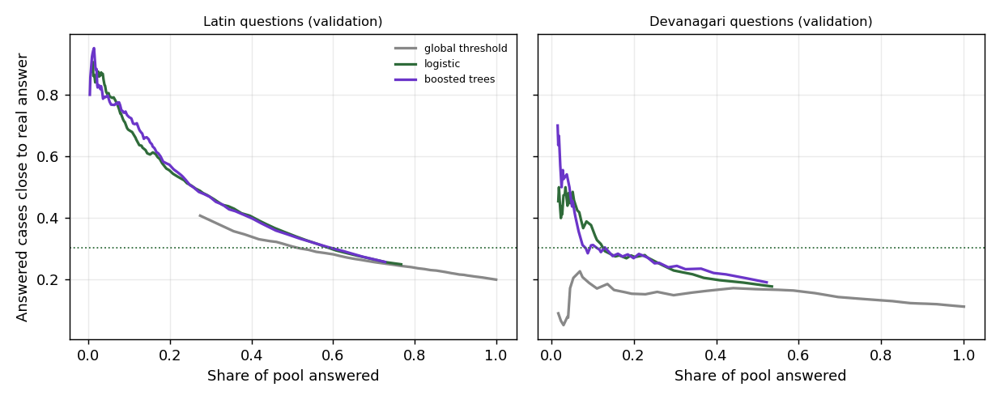

# Stage 5 - Answerability model

Generated by `python -m src.triage.answerability_train`. Method and the decision rule (fixed before the first run) are in the module docstring.

> "Close" is the Stage 2 proxy: char n-gram cosine >= 0.5 between the served past answer and the real answer on that call. Target close rate for answered cases: **30.3%** (80% of the 37.8% at which two real advisors agree). Marathi/Hindi questions are machine rephrasings of real calls: an upper bound until real farmer recordings exist.

## 1. Data (the low-risk pool)

| Split | Language | Questions sent | Reach the answer decision | Best answer close |
|---|---|---:|---:|---:|
| valid | en | 29,814 | 3,026 | 606/3026 (20%) |
| valid | mr | 600 | 263 | 27/263 (10%) |
| valid | hi | 600 | 367 | 44/367 (12%) |
| test | en | 40,000 | 2,687 | 389/2687 (14%) |
| test | mr | 400 | 185 | 22/185 (12%) |
| test | hi | 399 | 224 | 22/224 (10%) |

## 2. Models (validation, out-of-fold, grouped by question)

| Model | AUC all | AUC Latin | AUC Devanagari | Brier | Cut-off chosen |
|---|---:|---:|---:|---:|---:|
| logistic | 0.816 | 0.823 | 0.743 | 0.113 | 0.24 |
| boosted_trees | 0.818 | 0.823 | 0.757 | 0.111 | 0.26 |

Similarity alone (the Stage 2 rule's signal): AUC all 0.714, Latin 0.731, Devanagari 0.655.

Rules: global similarity threshold **0.9825** (Stage 2); per-script: Latin 0.9825, Devanagari **1.0100** (recalibrated on the Devanagari validation pool). The model also needs similarity >= 0.85 as a floor.

## 3. Test months (KB frozen at 2024-12)

Answered / close answers / close rate of answered [95% bootstrap CI], per language pool.

| Policy | English | Marathi | Hindi | Close answers, all |
|---|---|---|---|---:|
| global_threshold | 1112 / 302 / 27.2% [25%-30%] | 0 / 0 / - | 0 / 0 / - | **302** |
| per_script_threshold | 1112 / 302 / 27.2% [25%-30%] | 0 / 0 / - | 0 / 0 / - | **302** |
| logistic | 684 / 274 / 40.1% [36%-44%] | 24 / 9 / 37.5% [17%-58%] | 35 / 10 / 28.6% [14%-43%] | **293** |
| boosted_trees | 561 / 245 / 43.7% [40%-48%] | 16 / 6 / 37.5% [12%-62%] | 22 / 5 / 22.7% [9%-41%] | **256** |

English questions never seen before 2025 (*hard*): global_threshold 282 answered, 13.1% [10%-17%] close; per_script_threshold 282 answered, 13.1% [10%-17%] close; logistic 244 answered, 23.8% [18%-29%] close; boosted_trees 148 answered, 25.0% [18%-32%] close.

Whole test sample (40,000 rows, all routes): auto-answer coverage global_threshold 2.78%, per_script_threshold 2.78%, logistic 1.71%, boosted_trees 1.40%.

## 4. End-to-end checks (production engine)

| Check | Stage 2 rule | Candidate |
|---|---|---|
| Gate probes routed as expected | 31/37 | 32/37 |
| Stage 4 parity set, mr: answered / same answer as English | 0/80 / 0 | 6/80 / 4 |
| Dose questions answered, mr (must be 0) | 0/40 | 0/40 |
| Stage 4 parity set, hi: answered / same answer as English | 0/80 / 0 | 13/80 / 7 |
| Dose questions answered, hi (must be 0) | 0/40 | 0/40 |

Candidate checked end to end: **logistic**.

## 5. Decision

Rule (fixed before running): see the module docstring.

- Best model on validation (most close answers out-of-fold at its cut-off): `logistic`.
- (a) close rate >= 30.3%: model en 40.1% [36%-44%], devanagari 32.2% [20%-44%] -> met; per-script en 27.2% [25%-30%], devanagari - -> NOT met.
- (b) close answers on the test pool: model 293, per-script 302, global 302.
- (c) dose questions answered: model 0, per-script 0; chemical answers served: 0 by construction (the policy is only reached after the CHEMICAL_ANSWER rule).
- (d) probes: Stage 2 31, model 32, per-script 31 (of 37).
- Not part of the rule, for reading it: the Stage 2 rule itself is close 27.2% [25%-30%] on English test questions, BELOW the 30.3% target. Criterion (b) counts close answers without asking whether the baseline meets (a).

**Adopted: keep the Stage 2 rule.**
